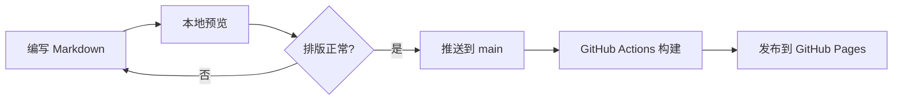
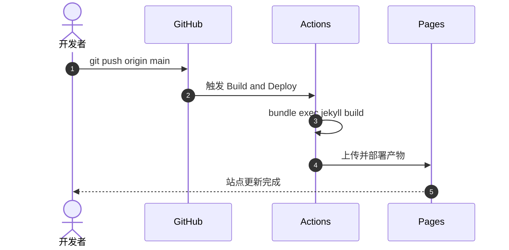

技术文章里经常需要画图和写公式，Chirpy 对这两者都提供了开箱即用的支持。
只需要在文章的 Front Matter 中打开对应开关即可。

## 打开开关

```yaml
---
title: 文章标题
math: true
mermaid: true
---
```

## 流程图

使用 `mermaid` 代码块编写流程图：



## 时序图



## 数学公式

行内公式用一对 `$` 包裹，例如质能方程 $E = mc^2$，或者欧拉恒等式 $e^{i\pi} + 1 = 0$。

独立成行的公式用两对 `$`：

$$
\int_{-\infty}^{\infty} e^{-x^2}\,\mathrm{d}x = \sqrt{\pi}
$$

$$
\begin{aligned}
\nabla \cdot \mathbf{E} &= \frac{\rho}{\varepsilon_0} \\
\nabla \cdot \mathbf{B} &= 0 \\
\nabla \times \mathbf{E} &= -\frac{\partial \mathbf{B}}{\partial t} \\
\nabla \times \mathbf{B} &= \mu_0 \mathbf{J} + \mu_0 \varepsilon_0 \frac{\partial \mathbf{E}}{\partial t}
\end{aligned}
$$

矩阵与分段函数也可以正常渲染：

$$
A = \begin{pmatrix}
a_{11} & a_{12} \\
a_{21} & a_{22}
\end{pmatrix},
\qquad
f(x) = \begin{cases}
x^2, & x \ge 0 \\
-x, & x < 0
\end{cases}
$$

> 公式由 MathJax 在浏览器端渲染。如果公式没有显示，先检查 Front Matter 中是否设置了
> `math: true`，以及网络是否可以访问 CDN 上的 MathJax 脚本。
{: .prompt-tip }

## 小结

- 图用 `mermaid` 代码块，文章头部加 `mermaid: true`
- 公式用 `$…$` 或 `$$…$$`，文章头部加 `math: true`
- 图片依然放在 `assets/img/` 下，用相对站点根目录的路径引用

更多排版示例见 [Markdown 排版示例](/posts/markdown-showcase/)。
